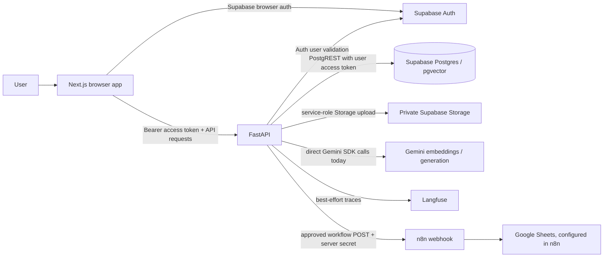

# BizFlow AI Project Audit

**Audit date:** 2026-11-05
**Scope:** Phase 1 repository inspection only. No application code, migrations, secrets, or external services were changed or exercised.
**Evidence standard:** “Implemented” means code paths exist in this checkout. The audit did not run tests or verify live Supabase, Gemini, n8n, Google Sheets, or Langfuse accounts. Claims in README/progress about prior live verification are recorded as repository claims, not independently confirmed results.

## Executive summary

BizFlow AI is an existing Next.js + FastAPI application, not an empty scaffold. It has Supabase-backed authentication, private document uploads, PDF/DOCX/TXT/MD parsing, Gemini embedding and generation services, vector retrieval and cited answers, document metadata/summary/proposal/email draft generation, workflow preview/approval/execution code, and Langfuse instrumentation. Automated backend tests cover these slices, with CI workflows for backend and frontend checks.

Several production-critical contracts do not match the implementation or each other. Most notably, `model_router.py` is still a stub while embedding and generation call Gemini directly; the initial migration drops and recreates `document_chunks`; workflow execution has no atomic compare-and-set/idempotency guard and its persisted schema lacks execution/approval timestamps and an n8n execution ID; and the frontend Settings and dashboard activity pages are placeholders. Documentation is stale in several places and overstates what can be verified from this repository. A checked-in `apps/api/.env` exists locally (its contents were intentionally not read or reproduced); it is ignored by Git.

**Recommended immediate order:** preserve data and inspect deployment state; reconcile migration/API/docs and secret handling; harden workflow transitions/idempotency; centralize model calls; complete the missing frontend and production configuration; then run the full automated suite and controlled live integration checks.

## Architecture overview



- **Frontend:** `apps/web` uses Next.js App Router, React, TypeScript and Tailwind. The browser Supabase client handles email/password sign-in and session persistence. `ApiClient` reads the current access token and attaches it as a Bearer token to FastAPI calls. Dashboard pages include document actions, RAG search/answer, and workflow preview review/approval/execution. Settings and the top-level dashboard activity are placeholders.
- **Backend:** `apps/api/app/main.py` registers health, auth, documents, RAG and workflow routers. `core/security.py` validates supplied tokens by calling Supabase Auth `/auth/v1/user`; protected services derive ownership from that verified identity. Service modules call Supabase REST/Storage APIs using `httpx`, use Google GenAI SDK directly for embeddings and text generation, call n8n only from `n8n_service.py`, and wrap selected operations with Langfuse tracing.
- **Supabase:** Supabase Auth is the identity authority. PostgREST stores documents, chunks and workflow runs; a migration also creates unused-for-now conversations, messages and model_events tables. Storage stores originals under a user-prefixed path. A SQL RPC returns cosine-similarity-ranked chunks and checks `auth.uid()` against the requested user ID. RLS policies and grants are defined for the user-owned tables.
- **AI:** `EmbeddingService` invokes Gemini `gemini-embedding-001` and expects 3072 dimensions. `GenerationService` invokes the configured Gemini chat model (default `gemini-2.5-flash`). The nominal `ModelRouter` is unimplemented and these services bypass it. No LiteLLM routing to DeepSeek/OpenAI/Claude is present in runtime code.
- **Automation:** a workflow preview is persisted, approval is persisted, then the backend calls the configured n8n URL using `N8nService` and a server-side header secret. The service accepts a JSON/non-JSON success response and returns metadata to the workflow service. Google Sheets is described in README/progress as an n8n-side step, but no n8n export/configuration is checked into this repository, so the node chain and live logging are not independently verifiable here. No email-send integration exists; only drafts are generated.
- **Observability:** `ObservabilityService` starts and updates Langfuse observations when enabled and configured, and degrades to no-op when unavailable. It instruments RAG answers, metadata, summaries, proposals, email drafts and workflow execution.

## Technology stack and repository structure

| Area | Found in repository |
| --- | --- |
| Web | Next.js 16, React 19, TypeScript strict mode, Tailwind 4, Supabase JS |
| API | FastAPI, Python 3.12, Pydantic Settings, httpx, uv |
| Auth/data/files | Supabase Auth, Postgres/PostgREST, pgvector, Supabase Storage |
| AI | Google GenAI SDK; configured Gemini embedding and chat models |
| Parsing | pypdf, python-docx |
| Automation/tracing | n8n webhook client, Langfuse client |
| Checks | pytest, Ruff, Mypy, ESLint, Next build; GitHub Actions for API and web |

```text
apps/api/app/{api,core,schemas,services}/   FastAPI routes, auth/settings, contracts, logic
apps/api/tests/                              Backend unit/route/service tests
apps/web/app/                                Landing, login, dashboard routes and layouts
apps/web/src/{components,lib}/               UI patterns, auth, Supabase and API clients
supabase/migrations/                         One initial schema/RLS/RPC migration
docs/                                        Product, design, API, schema, security, testing, progress
scripts/                                     Local dev, test, environment checks
.github/workflows/                           API and web CI
```

Other deployment artifacts include `.env.example`, `.gitignore`, and an empty `docker-compose.yml`. No Render/Railway/Vercel deployment manifest or n8n workflow export was found. `apps/api/.env` is present in the working tree but ignored; values were not inspected or copied.

## Feature implementation status

| Feature | Observed implementation | Status / verification limit |
| --- | --- | --- |
| Authentication | Supabase browser sign-in/sign-up/session; backend calls Supabase Auth user endpoint; `/me` | Implemented; tests exist. Live auth not verified in this audit. |
| Dashboard | Protected layout, sidebar, documents/chat/workflows/settings | Partially implemented; overview and settings explicitly show placeholder content. |
| Upload/list | Extension and size checks, SHA-256 duplicate lookup, Storage upload, user-scoped document row/list | Implemented; CSV is accepted by route/UI but no CSV extraction branch is evident in ingestion (see risks). |
| Ingestion | TXT/MD, DOCX, PDF text extraction; fixed character windows with overlap; Gemini embeddings; chunks and statuses persisted | Implemented; OCR/scanned PDF not supported. Existing tests cover ingestion and embeddings. |
| RAG search/answer | Query embedding, Supabase RPC similarity search with user scoping, answer generation and source citation objects | Implemented; no chat history, hybrid retrieval or evaluation suite. Tests exist. |
| Metadata/summary/proposal/email draft | Per-document service routes use chunks and generation; persist fields in metadata/summary | Implemented; outputs are drafts. Automated tests exist; live provider behavior not verified. |
| Workflow preview/approval | Database-backed preview and owner-scoped approve endpoint | Implemented, but transition update is not atomic and schema lacks approval timestamp. |
| Workflow execution | Approved flag checked in service, state set running, N8nService HTTP POST, then completed/failed update | Partially implemented for production: duplicate/concurrent execution race, no durable execution ID/timestamps, no response contract validation or tested retry/idempotency semantics. |
| Google Sheets | README/progress claim n8n logs to Sheets | Not verifiable from checkout; no n8n JSON/config is present. |
| Email automation | Draft generation and copy-to-clipboard UI | Send action is not implemented; this is consistent with the requirement not to send without explicit approval/recipient authorization. |
| Langfuse | Best-effort instrumentation service and tests | Implemented in code; external trace delivery not verified. |
| Deployment | Health endpoint, env template, local scripts, CI | Partial; compose file is empty; no deployment manifests, migration runbook, production smoke test, or frontend typecheck script. |

### Frontend coverage

- Login page supports sign-in/sign-up and shows errors/submission state. Dashboard auth gate checks client session and handles loading, missing session and setup errors.
- Documents page is a large client workflow for upload/listing, ingestion, metadata, summary, proposal, email draft, and workflow preview. It includes loading/error/success state patterns; detailed responsive and duplicate-submit behavior has not been tested in this audit.
- Chat page offers search and generated answer actions, with result/citation display. It does not persist conversations.
- Workflows page lists runs, renders payload JSON, and offers approve/execute based on status. Its explanatory copy says external automation is “before ... connected,” conflicting with the implemented API client and README claims.
- Settings and dashboard home are static placeholders. No component tests are present. `package.json` has lint/build but no typecheck or test script (Next build may type-check as part of build, but was not run).

### Backend route surface

Implemented in route files: `GET /health`, `GET /me`, document list/upload/ingest/metadata/summary/proposal/email-draft, RAG search/answer, workflow list/preview/approve/execute. This differs from `docs/api-contract.md`, which marks several existing routes planned and omits actual routes. Errors generally use FastAPI `detail` responses, not the documented nested `error` shape.

## Bugs, technical debt, and security findings

### P0 — data preservation and authorization integrity

1. **Destructive migration behavior:** `supabase/migrations/0001_initial_schema.sql` contains `drop table if exists public.document_chunks cascade;` before recreating the table. The “early development reset” comment does not make this safe on an already-used database. Do not rerun this migration against data-bearing environments; schema evolution needs a non-destructive migration and a backup/restore plan.
2. **Workflow state race/idempotency:** approve and execution use separate read and unconditional PATCH operations. Two requests can both observe `pending` or `approved` and race into approval/execution; `running` is not a claim guarded by an atomic status predicate. A network timeout after n8n accepted a webhook can cause a retry and duplicate side effects. Require atomic transitions/idempotency keys before production use.
3. **Model boundary violation:** `model_router.py` raises `NotImplementedError`, while embedding/generation modules call the Gemini SDK directly. This contradicts both `AGENTS.md` and the intended provider/observability boundary. Multi-provider routing is not implemented.

### P1 — correctness and production readiness

4. **Workflow persistence contract incomplete:** migration has `approved_by_user`, `error_message`, and generic timestamps only. It lacks `approved_at`, `execution_at`, `completed_at`, `n8n_execution_id`, and a dedicated validated execution result. Workflow schema allows a `sent` status that the requested flow does not define. Approval identity is reduced to a boolean; owner identity is implicit in row `user_id`.
5. **n8n response handling is loose:** timeout is hard-coded at 30 seconds; any 2xx response is treated as completed; malformed/non-object responses are wrapped rather than rejected; no execution identifier is normalized/validated. Failure text is persisted from service errors. No local importable workflow is available to verify the expected payload/secret/Sheets behavior.
6. **Upload/ingestion gaps:** CSV is accepted in route/UI and `.env.example` content types but ingestion extraction branches only cover text, Markdown, PDF, and DOCX, so CSV upload can fail during ingestion. Upload reads the whole file into memory before the size check. Validation is extension/declared MIME based rather than content-signature based. The service-role key is used for Storage, making Storage policy/configuration especially important.
7. **Prompt and log hygiene needs review:** RAG prompt explicitly treats document text as untrusted, but metadata, summary, proposal, and email generation prompts need a consistent prompt-injection review. `ingestion_service.py` logs Supabase error body and failure details; `document_service.py` logs response body; exception text may contain private content or provider/database details. Existing claims of safe logs should be checked against these paths.
8. **CORS production behavior:** `get_cors_origins()` always adds localhost origins to configured origins. Production configuration should not retain development origins by default. `allow_methods` and `allow_headers` are wildcard.
9. **Frontend gaps:** Settings and dashboard home remain placeholders; workflow page copy is stale; no persisted chat; no frontend component tests or standalone typecheck command; API client error parsing supports only string `detail` and assumes JSON success bodies.
10. **Operational gaps:** `docker-compose.yml` is empty. Health is process-only and does not report dependency readiness. No deployment manifests, migration safety procedure, or n8n workflow definition exists in the checkout.

### P2 — maintainability and documentation drift

11. **Docs are inconsistent:** README/architecture/progress describe relatively complete RAG/workflow/n8n features, while `docs/context-summary.md`, `docs/api-contract.md`, `docs/database-schema.md`, `docs/rag-design.md`, and the top of `docs/progress.md` describe the early upload-only state. The docs disagree about PDF/DOCX, routes, schema/table names, model routing, and n8n completion. README itself lists LiteLLM routing as a roadmap item while also describing direct Gemini use.
12. **Schema and implementation drift:** database docs describe `chat_sessions`, `chat_messages`, `workflow_requests`, and extraction/proposals tables; migration instead creates conversations/messages/workflow_runs/model_events and generated outputs are stored in documents JSON metadata. Conversations/messages currently have no routes.
13. **Loose status semantics:** document status values are accepted by frontend/backend but lack database constraints; chunk re-ingestion and duplicate processing behavior need validation. Workflow status values are similarly not constrained at the database level.
14. **Missing broader verification:** no observed Supabase integration/RLS policy tests, frontend tests, RAG relevance/citation evaluation set, browser E2E run, or external n8n/Sheets controlled verification artifact.

## Deployment and integration blockers

- Confirm the live database has not been subject to the destructive chunk-table reset; establish a safe, additive migration baseline before further schema changes.
- Configure and verify production Supabase URL/keys, Storage bucket policies, Auth JWT validation, RLS, grants, and private bucket behavior. This audit did not access the project.
- Decide whether the product is Gemini-only for the near-term or implement the required LiteLLM router; current env template includes several unused provider variables.
- Make workflow execution atomic and idempotent, add durable lifecycle fields, validate n8n responses, and add a versioned importable n8n workflow with Google Sheets configuration placeholders.
- Production CORS should derive from explicit production origins. Add API/web deployment configuration, dependency-aware health/readiness, and documented rollback/smoke tests.
- Fix docs/environment drift and confirm required variables. No values from `apps/api/.env` were inspected; no secrets are included in this report.
- `docs/progress.md` claims prior Google Sheets execution verification, but there is no n8n workflow file or test artifact in this repository to reproduce it. Verify in a controlled environment before describing this as operationally proven.

## Prioritized implementation plan

This sequence is an implementation proposal for review. Phase 1 itself made no code changes.

| Priority | Work slice | Main files/areas | Completion evidence |
| --- | --- | --- | --- |
| 0 | Protect existing data and reconcile source-of-truth docs; inspect deployed migration state before applying any migration | `supabase/migrations/`, `docs/{database-schema,api-contract,progress,context-summary,rag-design}.md`, README | Non-destructive migration plan; accurate route/schema/status inventory; explicit live-state confirmation |
| 1 | Close workflow approval/execution races and define idempotent webhook contract | `apps/api/app/services/workflow_service.py`, `n8n_service.py`, schemas, migration, workflow tests, frontend workflows page | Concurrent transition tests; duplicate/retry tests; persisted lifecycle/execution ID; validated n8n response; owner/approval tests |
| 2 | Centralize all model operations and unify provider/error/timeout/trace behavior | `model_router.py`, embedding/generation services, settings, tests, dependencies | No provider SDK calls outside router; direct service tests; provider configuration tests |
| 3 | Fix file handling and safe processing gaps | document routes/service, ingestion, tests, upload UI | CSV either truly supported or rejected consistently; bounded streaming/read size; content validation; safe re-ingest/status behavior |
| 4 | Complete and correct frontend user flows | dashboard home, settings, documents/chat/workflows, API client | Real empty/loading/error/success states, consistent response types, duplicate-submit protection, responsive review, frontend typecheck/build and focused UI tests |
| 5 | Security and observability hardening | auth/config, logs/traces, SQL policies/RLS tests | Redacted errors/logs; CORS allowlist; automated cross-user/RLS tests; prompt-injection and citation tests |
| 6 | Reproducible n8n + Google Sheets workflow and optional approved email design | `docs/N8N_SETUP.md`, workflow JSON, n8n service/tests | Importable credential-free flow; signature/header validation; Sheets append idempotency; no unapproved email send; controlled end-to-end proof |
| 7 | Deployment preparation and final docs | deployment manifests, `.env.example`, health, README, `docs/DEPLOYMENT.md`, `docs/SECURITY_AUDIT.md`, `docs/IMPLEMENTATION_STATUS.md` | Repeatable setup/deploy/rollback/smoke runbook; successful CI and separately reported live integration checks |

## Audit scope notes

- Files reviewed include repository instructions, README, environment template, gitignore, migration, API and frontend manifests/configuration, backend routes/services/schemas/tests inventory, frontend route/client files, CI workflows, scripts, and existing architecture/API/schema/RAG/security/testing/progress/decision docs.
- `apps/api/.env` was observed by filename only. Its contents were not read, copied, or disclosed.
- No commands for pytest, Ruff, Mypy, ESLint, TypeScript, or Next build were run. CI definitions were inspected only.
- No database, migration, external API, n8n, Google Sheets, email, or deployment actions were performed.
