# Workflow Approval and Execution

## Scope and status

This document describes the backend contract implemented in this repository. Automated tests use mocked HTTP/database boundaries. No live Supabase schema, n8n endpoint, or Google Sheets workflow has been tested. The repository does not contain an independently verifiable n8n workflow export; configure the remote workflow to match this contract before enabling production calls.

## State transitions

```mermaid
stateDiagram-v2
  [*] --> pending: create preview
  pending --> approved: owner approves (conditional update)
  approved --> running: atomic execution claim + persist key
  failed --> running: retry only when prior result says definitely not delivered
  running --> completed: validated n8n completion response persisted
  running --> failed: definite pre-delivery failure
  running --> unknown: timeout, non-2xx, malformed response, or uncertain transport outcome
  unknown --> [*]: manual reconciliation required
  completed --> [*]
  sent --> [*]: legacy terminal value; preserved, not executable
```



`failed` is retryable only when `execution_result.outcome == "definite_failure"` and an idempotency key is already stored. Older failed records without that evidence cannot be retried automatically. `unknown` is deliberately non-retryable. The legacy `sent` value remains accepted for reading existing rows; this implementation does not transition into it.

## API behavior

- `POST /workflows/{workflow_id}/approve`: conditionally updates only a row matching the authenticated owner's ID, workflow ID and `status=pending`. The update sets `status=approved`, `approved_by_user=true` and `approved_at`. A concurrent/repeated request that no longer matches receives HTTP 409.
- `POST /workflows/{workflow_id}/execute`: reads the owner's workflow, verifies explicit approval, and then claims the row with a conditional database update matching the observed status and owner. For an initial execution, the claim sets `running`, a new stable key and `execution_started_at` before sending any webhook request. For a retry after a recorded definite failure, the update requires the same old key and reuses it.
- A claim that updates no row does not call n8n and returns HTTP 409.
- `GET /workflows` returns lifecycle timestamps, n8n execution ID, validated execution result and status. The idempotency key is used internally for retry coordination; it is not an authorization credential.

All database calls use the authenticated Supabase access token and owner filter. The service does not use a read followed by an unconditional status update as its transition guard; the conditional PostgREST PATCH predicate is evaluated with the database update. Live concurrency semantics still need an integration check against the actual Supabase/PostgREST project.

## Idempotency and retries

The API creates a UUID idempotency key during the first atomic `approved -> running` claim, persists it before calling n8n, and sends the same value both in the JSON request and the `Idempotency-Key` header. A retry after a definite connection failure reads and reuses the persisted key. The API never retries automatically.

This is **not end-to-end exactly-once execution**. n8n must durably deduplicate the key before external side effects, and every side effect (for example a Sheets append) must be protected against replay. There is no n8n export or deduplication store in this repository, so this guarantee is not currently demonstrated.

### Definite failure versus unknown outcome

- **Definite failure:** missing local configuration/approval/key, or an `httpx.ConnectError` before a connection is established. The row becomes `failed` with `execution_result.outcome=definite_failure`. A user may explicitly retry; the key remains unchanged.
- **Unknown outcome:** read/write timeout, other transport error, any non-2xx response, invalid JSON/schema, mismatched workflow ID, or failure to persist completion after n8n might have completed. The workflow becomes `unknown` when the backend can persist that finding. Do not retry; reconcile the workflow ID/key against n8n execution history and side effects first.
- If the process stops after claiming `running` but before it can record an outcome, the row remains `running`. Treat stale `running` as potentially unknown and reconcile manually. No lease/reaper or automatic re-dispatch is implemented.
- If n8n completed a side effect but the completion database write failed, the row can remain `running`; do not execute it again until reconciled.

## n8n request and response contract

Request method is `POST`. The URL and secret are backend-only settings. The API sends `X-BizFlow-Webhook-Secret` for authentication and `Idempotency-Key` for deduplication. Example values below are placeholders:

```json
{
  "workflow_id": "00000000-0000-0000-0000-000000000001",
  "workflow_type": "proposal_follow_up",
  "document_id": "00000000-0000-0000-0000-000000000002",
  "input_payload": {"filename": "client-brief.pdf"},
  "output_payload": {"approval_required": true},
  "approved_by_user": true,
  "idempotency_key": "stable-key-for-this-workflow-execution"
}
```

The synchronous success response must be valid JSON with exactly this supported shape (extra fields are rejected):

```json
{
  "workflow_id": "00000000-0000-0000-0000-000000000001",
  "status": "completed",
  "execution_id": "n8n-execution-id-or-omit-this-field",
  "result": {"recorded": true}
}
```

The returned workflow ID must match the request. The API records `execution_id` as `n8n_execution_id` and `result` in `execution_result`. A 2xx response by itself is not success. An asynchronous acknowledgement such as `accepted` is not implemented: without a callback/polling endpoint it is treated as an unknown outcome. Agree on this contract with the n8n owner before configuring the webhook.

## Database prerequisite

`supabase/migrations/0002_workflow_execution_metadata.sql` must be reviewed and applied before deploying this implementation. The code selects and writes its new columns and returns an explicit schema-compatibility error when PostgREST rejects the fields. It has not been applied or tested against Supabase. Do not rerun `0001_initial_schema.sql`.

## Current verification and remaining work

- Unit tests mock n8n HTTP and model one conditional database update with an in-memory compare-and-set fake.
- No tests contact real Supabase or n8n; no live database concurrency test was run.
- No durable n8n dedupe or Google Sheets append dedupe is present in-repo.
- Validate webhook authentication, response shape, idempotency persistence, and side-effect deduplication in a controlled non-production environment before enabling execution.
- Add a repair/reconciliation process for stale `running` and `unknown` rows before production operations.
